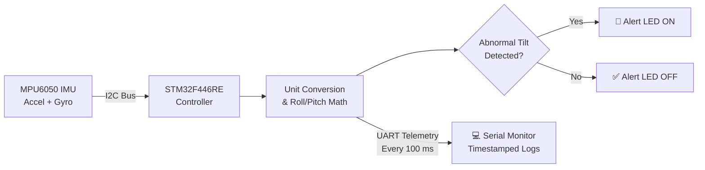

<div align="center">

# 🤖 I2C-Based Orientation & Motion Monitoring
### Industrial Tilt & Vibration Safety System using STM32F446RE & MPU6050

<p>
  
  
  
  
  
</p>

<p>
  <a href="#-overview">Overview</a> •
  <a href="#-system-architecture">Architecture</a> •
  <a href="#-hardware--pinout">Hardware</a> •
  <a href="#-orientation-math">Orientation Math</a> •
  <a href="#-implementation-roadmap">Tasks</a> •
  <a href="#-success-criteria">Success Criteria</a>
</p>

---

</div>

## 📌 Overview

> **Industrial Scenario**  
> An industrial material-handling robot must continuously monitor its tilt and movement to prevent unsafe operating conditions. The controller reads acceleration and angular velocity data from an **MPU6050** sensor over **I2C** and triggers visual alerts whenever excessive tilt or vibration is detected.

### 🎯 Project Statement
Interface the **MPU6050 6-axis IMU** with the **STM32F446RE** microcontroller over **I2C**, acquire raw accelerometer and gyroscope measurements, compute real-time **roll** and **pitch** angles, flag abnormal tilt states via an **LED**, and stream timestamped telemetry over **UART** at fixed 100 ms intervals.

---

## 🏗️ System Architecture



---

## 🔌 Hardware & Pinout

| Component | Interface | Typical Nucleo-F446RE Pin | Function |
| :--- | :---: | :---: | :--- |
| **MPU6050 (SCL)** | I2C1 | `PB8` | Serial Clock Line |
| **MPU6050 (SDA)** | I2C1 | `PB9` | Serial Data Line |
| **MPU6050 (VCC / GND)** | Power | `3.3V` / `GND` | Power Supply |
| **Status Alert LED** | GPIO Output | `PA5` (Onboard LD2) | Abnormal Tilt Indicator |
| **USB-UART Bridge** | USART2 | `PA2` (TX) / `PA3` (RX) | Timestamped Data Logging |

> **Note:** Pin mappings above reflect the standard NUCLEO-F446RE layout and can be remapped in STM32CubeMX as needed.

---

## 📐 Orientation Math

Raw 16-bit sensor readings are converted into engineering units ($g$ for acceleration, $^\circ/\text{s}$ for angular velocity) using the configured full-scale sensitivity factors. Roll ($\phi$) and Pitch ($\theta$) are computed from the accelerometer components $(a_x, a_y, a_z)$:

$$\text{Roll } (\phi) = \arctan2\left(a_y,\ a_z\right) \times \frac{180}{\pi}$$

$$\text{Pitch } (\theta) = \arctan2\left(-a_x,\ \sqrt{a_y^2 + a_z^2}\right) \times \frac{180}{\pi}$$

---

## ⚙️ Sensor Setup & Telemetry Format

<details>
<summary><b>🔍 Click to expand: Key MPU6050 Register Workflow</b></summary>

| Step | Action | Purpose |
| :---: | :--- | :--- |
| **1** | Read `WHO_AM_I` (`0x75`) | Verify I2C communication & device identity (`0x68`) |
| **2** | Configure `PWR_MGMT_1` (`0x6B`) | Wake up MPU6050 from sleep mode |
| **3** | Configure `ACCEL_CONFIG` & `GYRO_CONFIG` | Set accelerometer & gyroscope full-scale ranges |
| **4** | Burst-read `0x3B` – `0x48` | Acquire raw 16-bit Accel (X, Y, Z) and Gyro (X, Y, Z) data |

</details>

<details>
<summary><b>🖥️ Click to expand: Sample UART Log Output</b></summary>

```text
[00:00:00.100] AX:  0.02g  AY: -0.01g  AZ: 1.00g | GX:  0.12dps GY: -0.05dps GZ:  0.00dps | Roll:  -0.57°  Pitch:  -1.15° | Status: NORMAL
[00:00:00.200] AX:  0.48g  AY:  0.03g  AZ: 0.87g | GX:  1.40dps GY: 14.20dps GZ: -0.10dps | Roll:   1.97°  Pitch: -28.88° | Status: TILT ALERT [LED ON]
```

</details>

---

## 📋 Implementation Roadmap

- [ ] **Hardware Interfacing:** Connect MPU6050 to STM32F446RE via I2C.
- [ ] **Device Verification:** Identify and verify sensor presence using the `WHO_AM_I` register.
- [ ] **Sensor Configuration:** Set up accelerometer and gyroscope operating modes.
- [ ] **Data Acquisition:** Read raw accelerometer and gyroscope registers over I2C.
- [ ] **Engineering Conversion:** Scale raw register values into physical units ($g$ and $^\circ/\text{s}$).
- [ ] **Orientation Calculation:** Compute roll and pitch angles from accelerometer measurements.
- [ ] **UART Telemetry:** Transmit timestamped sensor readings and orientation values every 100 ms.
- [ ] **Safety Alerting:** Detect abnormal tilt thresholds and indicate status using an LED.
- [ ] **Manual Validation:** Physically vary sensor orientation and log measured vs. expected results.
- [ ] **Documentation:** Record I2C communication transactions, orientation accuracy, and test observations.

---

## ✅ Success Criteria

| Metric | Target Requirement | Verification Method |
| :--- | :--- | :--- |
| **I2C Reliability** | Stable communication with MPU6050 | `WHO_AM_I` check & zero bus lockups |
| **Sensor Readout** | Accurate accelerometer & gyroscope values | Cross-check resting gravity ($1g$ on Z-axis) & rotation response |
| **Update Rate** | Roll & pitch computed every **100 ms** | Verify timestamp deltas in UART logs |
| **UART Logging** | Clear display of sensor & orientation data | Inspect serial terminal output |
| **System Endurance** | Continuous error-free run for **$\ge$ 5 minutes** | 5-minute soak test without I2C/UART dropouts |

---

## 📊 Validation & Test Observations

> Populate this section after hardware testing with your recorded measurements.

| Test Case | Physical Orientation | Expected Angle | Measured Angle | LED Alert State |
| :--- | :--- | :---: | :---: | :---: |
| **Flat Level** | $0^\circ$ Roll / $0^\circ$ Pitch | $0^\circ$ / $0^\circ$ | `TBD` | `OFF` |
| **Roll Tilt** | $+30^\circ$ Roll | $+30^\circ$ | `TBD` | `ON / OFF` |
| **Pitch Tilt** | $-30^\circ$ Pitch | $-30^\circ$ | `TBD` | `ON / OFF` |
| **5-Min Soak Test** | Continuous Operation | 0 I2C Errors | `TBD` | `PASS / FAIL` |

---

<div align="center">
  <sub>Built for Embedded Systems & Robotics Safety • STM32F446RE + MPU6050</sub>
</div>
